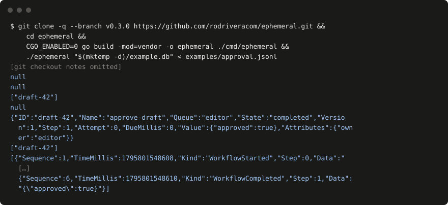
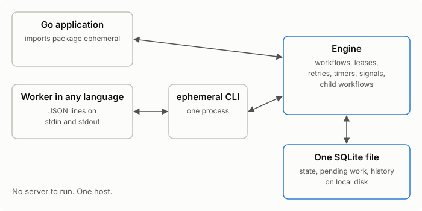
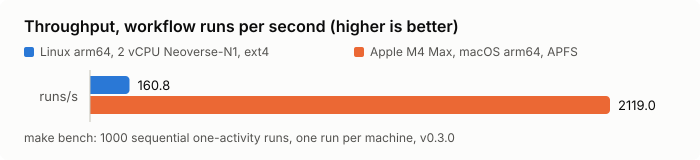
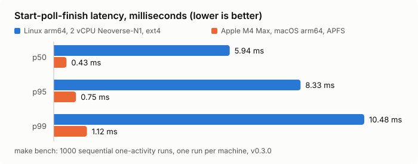

# Ephemeral

**Approvals, retries and timers that survive a restart, with one local SQLite database and no server to run.**

Ephemeral is a small durable workflow engine for one host, released for Linux ARM64. Workflow state, pending work and history are committed to a local SQLite database. Embed the Go package, or send JSON lines to the CLI from a worker in any language. Activities with retries run at least once; see [Execution model](#execution-model) and [Scope](#scope) for the limits.



*A real run of the approval example. [How it was captured](#about-the-visuals).*

<picture>
  <source media="(prefers-color-scheme: dark)" srcset="docs/img/architecture-dark.svg">
  
</picture>

## Quick start

### From source, macOS or Linux

This is the run shown above; it took 9.1 seconds in that one run.

Run as: your normal user. Where: a macOS or Linux machine with Git and Go 1.25+, in a directory without an `ephemeral` folder. sudo: no.

```sh
git clone -q --branch v0.3.0 https://github.com/rodriveracom/ephemeral.git &&
  cd ephemeral &&
  CGO_ENABLED=0 go build -mod=vendor -o ephemeral ./cmd/ephemeral &&
  ./ephemeral "$(mktemp -d)/example.db" < examples/approval.jsonl
```

### From the release binary, Linux ARM64

This registers an approval workflow, starts a run, approves it and reads the history, using the v0.3.0 release binary.

Run as: your normal user. Where: a Linux ARM64 host with curl, tar and sha256sum, in an empty directory. sudo: no.

```sh
base=https://github.com/rodriveracom/ephemeral/releases/download/v0.3.0
curl -fsSLO "$base/ephemeral-0.3.0-linux-arm64.tar.gz"
curl -fsSLO "$base/SHA256SUMS"
sha256sum --check --ignore-missing SHA256SUMS
tar -xzf ephemeral-0.3.0-linux-arm64.tar.gz
cd ephemeral-0.3.0-linux-arm64
./ephemeral "$(mktemp -d)/example.db" < examples/approval.jsonl
```

There is one reply line per request. The third lists `draft-42` as waiting, and the fifth shows it completed with `{"approved":true}`. The [examples guide](examples/README.md) continues from here.

## What makes it different

- **Nothing to operate.** The engine is a Go package and a CLI. Your data is one local SQLite database.
- **State survives restarts.** Reopen the database and runs continue from their saved step. Your code is not replayed.
- **Leases fence off late workers.** A stale or expired token cannot finish an activity.
- **Safe redelivery.** `start-once` returns false for a repeated request and rejects a changed one.
- **Workflows, not only jobs.** Approval signals, timers, branches, and child and parallel workflows, with ordered history.

It is not a distributed system: no network API, no multi-host failover, and no authentication or encryption of stored data. See [Scope](#scope).

## Performance

<picture>
  <source media="(prefers-color-scheme: dark)" srcset="docs/img/throughput-dark.svg">
  
</picture>

<picture>
  <source media="(prefers-color-scheme: dark)" srcset="docs/img/latency-dark.svg">
  
</picture>

One run per machine, so variation is not measured. Use the Linux numbers for planning. Commands and receipts are under [Measured results](#measured-results).

## Status

As of 2026-11-27.

| Item | State |
|---|---|
| Latest release | [v0.3.0](https://github.com/rodriveracom/ephemeral/releases/tag/v0.3.0), published 2026-11-26, Linux ARM64 binary and source archives |
| Released code | v0.3.0 is commit `c2e078a` |
| On main, not yet released | Documentation changes only |
| In review | See [open pull requests](https://github.com/rodriveracom/ephemeral/pulls) |
| Other platforms | No release binary; build from source |

## Measured results

All results are for commit `c2e078a`, with Go 1.27.0 unless stated. The gate and install runs were on 2026-11-26; the benchmark and test-count runs were on 2026-11-27. A receipt digest is the SHA-256 of the original run log. The host logs are kept by the maintainers and are not published.

| Result | Exact command | Host | Receipt |
|---|---|---|---|
| Passed. Tests reported ok with cgo and `-race` in 1.621s (engine) and 1.443s (CLI), and without cgo in 0.577s and 0.420s | `make verify && make release && make release-check` | Apple silicon macOS (Darwin arm64) | `ef689c36a2d27341503a3d34d6c7944448fab88cf59e6cb02c2c777e4a5a8577` |
| Passed. Release archives built and matched SHA256SUMS (this run did not run tests) | `make release && make release-check` | ARM64 Linux host | `e243891f83d95d5df5e5609428bb371f253cb63005e419b383b8d69504f460cd` |
| Passed. Published binary matched SHA256SUMS, installed and reported 0.3.0; the module resolved from an empty cache | Published-archive install and `go get` smoke test of v0.3.0 | ARM64 Linux host | `f784e7d0a9737aad67bf64e86d2d5da90dba4592094d9981c69e4be13f8e1e9f` |
| Passed. Tests, examples, release build and verify | `make test test-portable examples release verify` | GitHub Actions `ubuntu-24.04-arm` | [run 45870777737](https://github.com/rodriveracom/ephemeral/actions/runs/45870777737) (Go version from go.mod; no log digest) |

Test times are the package times Go printed for one run. They are not performance benchmarks.

Test counts, without cgo, using `CGO_ENABLED=0 go test -mod=vendor -count=1 -v ./...`. The skipped test is the benchmark, which runs only under `make bench`.

| Host | Top-level tests | Receipt |
|---|---|---|
| Linux arm64, 2 vCPU Neoverse-N1, ext4 | 18 passed, 1 skipped, 0 failed | `781b874dde4279708374d1603017ddd1c4be4c92c7574e60b2b35a67165b9390` |
| Apple M4 Max, macOS arm64, APFS | 18 passed, 1 skipped, 0 failed | `d1f8e6849a1c1ca2ae57990b0e4521f169691c27104bdff45ae67291bdfad7ca` |

### Benchmark

`CGO_ENABLED=0 make bench` runs 1000 workflows one after another, each with a single activity: start, poll, finish. One run per host, so there is no measure of variation.

| Measure | Linux arm64, 2 vCPU Neoverse-N1, ext4 | Apple M4 Max, macOS arm64, APFS |
|---|---|---|
| Total time, 1000 runs | 6.22 s | 0.47 s |
| Throughput | 160.8 runs/s | 2119.0 runs/s |
| Latency p50 | 5.94 ms | 0.43 ms |
| Latency p95 | 8.33 ms | 0.75 ms |
| Latency p99 | 10.48 ms | 1.12 ms |
| Database size after close | 708608 bytes | 708608 bytes |
| Receipt | `4d2536175f2af3acd075f7f75af8c83e1d4900bc25b1e86153a26db5906aca18` | `b67d792a5a9f4d75a52500f33256c3f0a7cb6b5c2f169f20590c2873bc856b19` |

Use the Linux column for planning: releases target Linux. The reason for the gap between the hosts has not been measured. Concurrent workers, idle polling cost and crash recovery time are not yet measured; `make bench` does not cover them.

## Install and build

Embed the Go package with `go get github.com/rodriveracom/ephemeral@v0.3.0`. The module path is `github.com/rodriveracom/ephemeral`. Use v0.3.0 or later; v0.2.1 predates the module path.

To build from source instead, clone the repository and build the CLI (Go 1.25+, no C toolchain needed):

Run as: your normal user. Where: a Linux or macOS machine with Git, Go 1.25+, Make and a POSIX shell, in the directory that should hold the clone. sudo: no.

```sh
git clone https://github.com/rodriveracom/ephemeral.git
cd ephemeral
make arm64   # static Linux ARM64 binary in dist/linux-arm64/ephemeral
# or: CGO_ENABLED=0 go build -mod=vendor -o ephemeral ./cmd/ephemeral
```

On a Linux ARM64 host, download the versioned Linux ARM64 tarball and SHA256SUMS from the v0.3.0 GitHub Release. Verify the downloaded file and install the standalone binary.

Run as: your normal user. Where: the Linux ARM64 host, in the directory holding the two downloads. sudo: no.

```sh
sha256sum --check --ignore-missing SHA256SUMS
tar -xzf ephemeral-0.3.0-linux-arm64.tar.gz
install -Dm755 ephemeral-0.3.0-linux-arm64/ephemeral "$HOME/.local/bin/ephemeral"
"$HOME/.local/bin/ephemeral" --version
```

The source tarball includes dependencies for offline builds. From its root, run `make arm64` to cross-compile from Go 1.25+ without a C toolchain. The static build embeds SQLite. Use `make build` for a smaller native Linux binary linked to the system SQLite library (requires a C compiler). Run `make test test-portable` for both backends and `make demo` for a local workflow.

`make release` builds both distribution archives and a SHA256SUMS file in dist/. `make verify` runs gofmt, go vet and both test backends, builds the release, and runs scripts/check_archives.py. That script reads each archive in full and fails on a truncated archive, a member outside the archive's top directory or an unexpected top-level entry. The binary tarball must hold exactly the binary, LICENSE, README, CHANGELOG, examples and notices. The source tarball must hold LICENSE, README, CHANGELOG, VERSION, Makefile, go.mod, scripts and vendor, and no dist, .git, bin or built binary. It does not check SHA256SUMS against the archives it just built; after `make release`, run `make release-check` to check them in a fresh directory. dist/ and SHA256SUMS must each name exactly this version's binary and source archives. It fails on a missing, extra or unlisted archive, a malformed SHA256SUMS line or a checksum mismatch. Verify downloaded releases with `sha256sum --check --ignore-missing SHA256SUMS`. The GitHub Actions workflow runs native ARM64 tests on pull requests and version tags, then attaches the archives to a GitHub Release when the tag matches VERSION.

## Branches, child workflows and parallel steps

A switch selects a forward label by comparing a top-level string field in the current JSON value. A missing field, another JSON type, or an unmatched string selects the default. A step falls through to the next step unless it sets next. The reserved target $end completes the run with its current value.

Register referenced child versions before registering the parent. This example runs a full review in two independent queues or routes a quick review to a single child.

```json
[
  {"kind":"switch","field":"mode","cases":{"full":"full_review"},"default":"quick_review"},
  {"kind":"child","label":"quick_review","children":[{"name":"lint","version":1}],"next":"$end"},
  {"kind":"parallel","label":"full_review","children":[{"name":"lint","version":1,"queue":"lint"},{"name":"audit","version":2,"queue":"audit"}]}
]
```

Child creation and the parent's wait commit together. Children inherit the parent queue unless they specify another. Poll every participating queue, including the parent queue, to drive progress. A single child returns its value directly. A parallel step waits for all children to settle and returns an array ordered by declaration. A failed or independently cancelled child fails the parent at the join. Cancelling a parent cancels its active descendants atomically. Parent history records each group's child IDs and the joined result.

## Runnable examples

Run `make examples` from the source root to execute the CLI approval workflow, activity worker, parallel review, and embedded Go retry example. Individual commands, expected results, and an inspectable JSON request sequence are in [the examples guide](examples/README.md).

## Execution model

Register an immutable (name, positive version) definition containing an ordered list of steps. Start a unique run ID pinned to that version on a named queue. The initial JSON value becomes the first activity's input. A successful activity replaces it with its JSON result. A signal step replaces it with the consumed payload. Timers preserve it. The final value is the workflow result. New versions can coexist with active older runs.

Poll from a worker loop, execute the named activity, and finish with its token. Poll returns JSON null when it has no task. The caller sets idle polling frequency. Timers and timeouts advance only when their queue is polled, including after a restart. Each poll processes up to 32 internal transitions. A timer is an earliest eligible time. Worker clocks on a shared host use wall time. A periodic heartbeat can extend an active lease. Attempts includes the initial attempt and defaults to one. The retry delay is the fixed backoff_ms, or the matching retry_delays_ms entry. On expiry or explicit failure, the engine either schedules a fresh attempt or closes the workflow as failed. Cancellation fences off subsequent results. A running activity may already have acted externally.

The local state, pending work, and history for each transition commit together under SQLite WAL with synchronous FULL. Keep the database on local storage. Use SQLite's online backup facility for live backups. Copying only the main file while WAL is active can lose recent commits. The database and its directory should be private to trusted clients.

Activities run with at-least-once semantics when retries are enabled. Use (run ID, step index) as a provider idempotency key across attempts. Tokens protect local commits. External side effects require provider-specific handling. Workflow recovery resumes from persisted state. The engine does not replay arbitrary Go code.

## CLI protocol

Run ./ephemeral DATABASE and send JSON objects, one per line. Each successful request returns one JSON value. A malformed or failed request exits nonzero and prints the error to stderr. Earlier successful requests remain committed. Each operation is independently atomic. Times and leases use milliseconds. For paginated reads use limit 1–1000.

| op | Fields | Result |
|---|---|---|
| register | name, version, steps | null; same immutable definition can be registered again |
| start | id, name, version, queue, value, attributes | null; duplicate run ID fails |
| start-once | id, name, version, queue, value, attributes | true when created, false for a matching replay; a different request for the same ID fails, as does any existing ID without a stored start fingerprint, such as one created by plain start or by an earlier release |
| poll | queue, leaseMS | task or null |
| next-due | queue | earliest runnable time in Unix milliseconds, or null |
| heartbeat | id, token, leaseMS | null |
| finish | id, token, value or nonempty failure | null |
| fail-permanent | id, token, nonempty failure | null; fails the run without further attempts |
| signal | id, key, name, value | null; retry with identical key, name and payload bytes is safe |
| cancel | id | null |
| attributes | id, attributes | upsert string keys and values |
| describe | id | run state, value, version, step, attempts, due time and attributes |
| history | id, after, limit | ordered events after the exclusive global sequence cursor |
| list | state (optional), afterID, limit | run IDs in ID order |
| find | key, equal, state (optional), afterID, limit | indexed exact string match in ID order, filtered by run state before pagination |

Activity steps accept kind, name, attempts and either backoff_ms or retry_delays_ms. A nonempty retry_delays_ms needs exactly attempts-1 entries, none negative, and no nonzero backoff_ms. Signal steps accept kind and name. Timer steps accept kind and millis. Queued signals survive restarts and are consumed once in arrival order within each name. History records transition events, including activity outcomes, signals and attribute changes. Event Data is text, with JSON payloads for structured events. History is retained until the database is removed. Indexed state and attribute queries read committed data directly.

## Event-driven workers

Use `StartOnce` (CLI `start-once`) when a durable input stream can redeliver a record. Choose a stable run ID scoped to the consumer, tenant and logical operation. After creation (true) or a matching replay (false), the consumer may commit its input offset. A conflicting request returns ErrStartConflict. The comparison covers definition name and version, queue, exact JSON input bytes and initial attributes. Attribute map order is immaterial. Nil and empty attribute maps are equivalent. IDs created with ordinary Start or earlier releases have no original fingerprint and return a conflict. Existing backup jobs can finish using the legacy registration path. Retain the workflow database for the entire redelivery window.

Activities may set `retry_delays_ms` to a list of nonnegative durations, one per retry. For example, attempts=3 and retry_delays_ms=[1000,10000] schedules the second attempt one second after failure and the third ten seconds after the next failure. The same policy applies after lease expiry. Use Finish for success or retryable failure and FailPermanent (CLI `fail-permanent`, fields id, token, failure) for a conclusive rejection. A lost external response can require reconciliation.

`NextDue(queue)` (CLI `next-due`) returns the earliest runnable time in milliseconds or an empty result. Workers can subscribe to an application's wake source before consulting NextDue and sleep until the earliest of a hint, due time or bounded fallback. The hint can become stale as other processes commit. Poll still verifies and claims work inside a write transaction. A queue without eligible work uses a read-only check.

## Scope

Workflows use forward-only graphs and statically declared child groups. The engine runs on one host with local SQLite storage. Remote transport, dynamic fan-out, loops and multi-host failover remain future work.

For scoped recovery, use FindInState(key, value, state, afterID, limit), or pass state to the existing find CLI operation. SQLite filters by the indexed attribute and workflow state before applying the page limit. A backup worker can select its binding and ready state directly and fetch details only for the matching runs.

## About the visuals

The terminal image is the output of one run of the source quick start on Apple M4 Max macOS arm64, from tag v0.3.0 (commit `c2e078a`), on 2026-11-27. It took 9.1 seconds from the first command to the last reply, including clone and build; network speed affects this. Git's checkout notes are omitted, long lines are wrapped, and the middle of the last line (the history) is cut, marked `[…]`. SHA-256 of the full program output: `b268d81130561dad8548f3e71fe778d0a2f9c35423351460952a594d3378f4bc`. The diagram is drawn by hand. The charts plot the numbers in [Measured results](#measured-results).

## Contributing

Open an issue or pull request at https://github.com/rodriveracom/ephemeral. Run `make verify` before submitting. It tests both SQLite backends, builds the release archives into dist/ and checks them, and runs gofmt and go vet. It needs Go 1.25+, Python 3, a C compiler and the system SQLite library (libsqlite3). Native ARM64 checks also run in GitHub Actions on pull requests.

Run as: your normal user. Where: a Linux or macOS machine with those tools, in the repository root. sudo: no.

```sh
make verify
```

## License

MIT. See [LICENSE](LICENSE).
